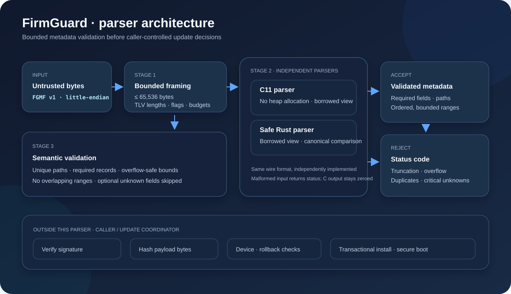
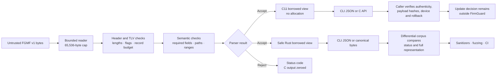
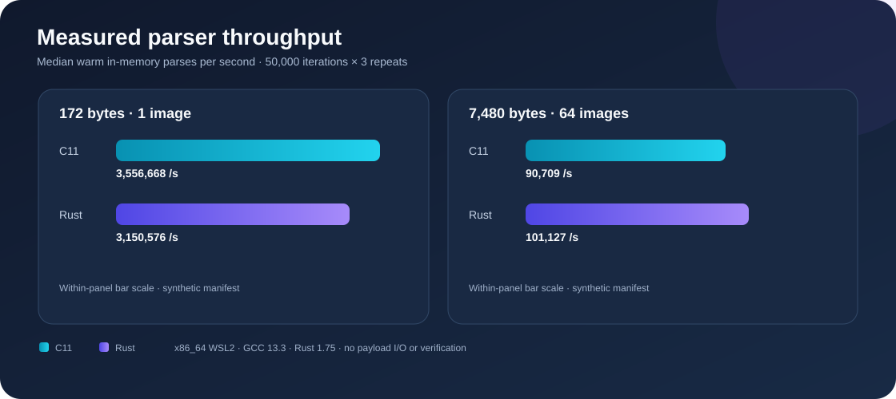

# FirmGuard


   

**A bounded C11 and safe Rust firmware manifest parser, built to examine hostile metadata before an update coordinator makes component or payload decisions.**

FirmGuard demonstrates parser hardening for a project-owned format called **FGMF v1**. It is not Apple, NVIDIA, UEFI, SUIT, or a vendor format, and the project has no vendor affiliation. The benchmark and fuzz results below describe controlled local tests, not a deployed updater or device fleet.



## Architecture



The two implementations independently parse the same format. The deterministic corpus checks that they return the same status and full accepted representation. Component paths are identifiers, not extraction destinations; the parser neither extracts nor flashes payloads.

## What it enforces

- Maximum manifest: **65,536 bytes**; maximum **64 images**, **512 records**, and **4,096 bytes per TLV value**.
- Unaligned little-endian reads without casting attacker-controlled input to structs.
- Required and duplicate field checks, fail-closed unknown critical fields, and bounded skipping of optional extensions.
- Overflow-safe payload range validation, image ordering, non-overlap, and unique component paths.
- C API returns no partial manifest on rejection; successful views borrow immutable caller input.
- C parser performs no heap allocation, I/O, recursion, or global mutation. Rust parser core contains no `unsafe` code.

## Measured results

On the recorded x86_64 WSL2 test host, **316** deterministic valid, malformed, boundary, and mutated inputs produced **zero C/Rust disagreements**. An AddressSanitizer/UndefinedBehaviorSanitizer libFuzzer session ran **3,535,719 inputs in 30 seconds without a crash**. The C concurrency check completed **80,000 parses across eight threads**.



The benchmark measured C11 at **3.56 million parses/s** for a 172-byte, one-image manifest and **90.7 thousand parses/s** for a 7,480-byte, 64-image manifest. Safe Rust measured **3.15 million** and **101.1 thousand parses/s**, respectively. Each result is the median of three 50,000-parse runs using GCC 13.3 and Rust 1.75. These are warm, in-memory parser measurements; they exclude payload I/O, signature/hash verification, and updater work. They are not an SLO or fleet-scale claim. See the [raw benchmark](docs/verification/latest-benchmark.json), [differential results](docs/verification/latest-differential.json), [fuzz run](docs/verification/latest-fuzz.json), and [verification notes](docs/VERIFICATION.md).

## Build and run

Requirements: C11 compiler, CMake 3.20+ or GNU Make, Rust 1.75+ with `rustfmt`, Python 3.10+, and Clang/libFuzzer for fuzz testing.

```sh
make all rust
make test sanitize differential format-check
make fuzz
make bench
```

Build and install the C library with CMake:

```sh
cmake -S . -B build/cmake -DCMAKE_BUILD_TYPE=Release
cmake --build build/cmake
ctest --test-dir build/cmake --output-on-failure
cmake --install build/cmake --prefix "$PWD/out"
```

Inspect a manifest from a file or stdin:

```sh
build/fg-inspect inspect manifest.fgmf
cargo run --manifest-path rust/Cargo.toml --release -- inspect manifest.fgmf
```

Both CLIs emit JSON, exit `0` for a valid manifest, `1` for a rejected manifest, and `2` for a CLI or input error. They cap input before parsing.

## Security boundary

FGMF v1 is a demonstration format. FirmGuard validates metadata structure and consistency; it does **not** authenticate original bytes, verify image hashes, establish device identity, enforce a trusted rollback floor, extract files, or apply updates. A successful parse is not authorization to flash a device. Those checks and transactional installation belong to a real, separately reviewed update system. Read the [requirements and integration boundary](docs/REQUIREMENTS.md) and [threat model](docs/THREAT_MODEL.md).

## Project map

```text
include/       public C API and bounds
src/           C11 parser
cli/           bounded C inspection CLI
rust/core/     safe Rust parser and CLI
rust/ffi/      C interoperability/test bridge
tests/         parser contract tests and libFuzzer harness
tools/         deterministic corpus, differential runner, benchmarks
docs/          format, architecture graphics, threat model, measured evidence
```

See the [FGMF v1 wire format](docs/FORMAT.md), [requirements](docs/REQUIREMENTS.md), [threat model](docs/THREAT_MODEL.md), and [verification guide](docs/VERIFICATION.md).
